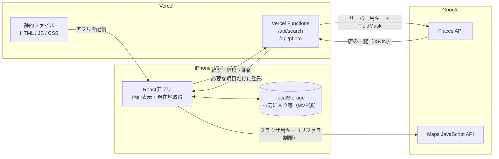
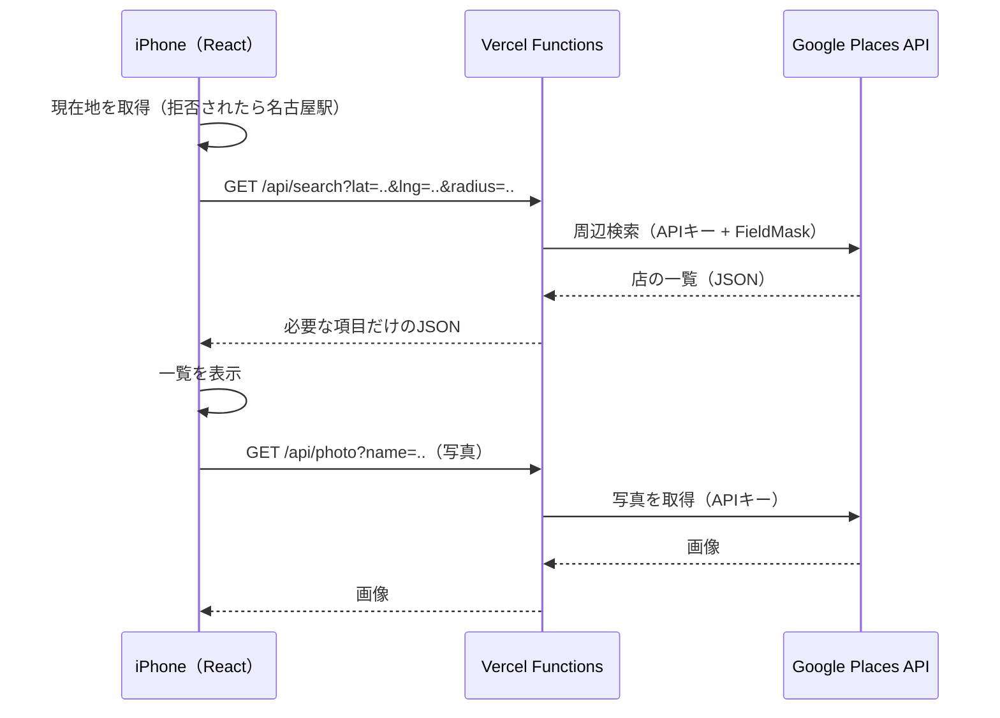

# 外食お店探しサポートWebアプリ 設計書

## 現在のスキル

- HTML/CSS/JavaScript は基本的なことだけ学んだことがある
- React もほんの少しだけわかる（JavaScript の延長的なイメージ）
- Git は少しわかる（コミットなど）

## 目標

- Reactでの画面づくりに慣れる
- 外部APIを安全に使う方法を覚える
- 自分のiPhoneで毎日使える状態まで公開する

## 1. 目的・利用シーン

外食で行きたい店を探すときに利用する。

## 2. 機能の洗い出し

- 現在地から検索距離範囲内のレストランをリストアップする
- 条件によってレストランの絞込みを行う
  - 絞込みのためにほしいレストラン情報
    - 場所
    - ジャンル（ラーメン、寿司など）
    - 評価
    - 営業時間と定休日
    - （できれば駐車場の有無）
    - 料金
- リストで店を選ぶとさらに詳細な情報が見える
  - 料理の写真
  - マップ
  - 口コミ
- 行く時間（または現在時刻）に営業していない場合わかるようにする
- 行ったことがある店ない店で分けれるようにしたい
- 気になる店とお気に入りの店を登録できるようにしたい

## 3. 画面設計

```
スタート画面（検索ボタンを配置）
  ↓ 検索
お店のリストが並ぶ画面
  ↓ お店をタッチ
お店の詳細画面
```

| 画面             | 表示するもの                                                                                                           |
| ---------------- | ---------------------------------------------------------------------------------------------------------------------- |
| スタート画面     | 検索ボタン                                                                                                             |
| お店のリスト画面 | お店の名前、ジャンル、距離、評価、営業時間、戻るボタン                                                                 |
| お店の詳細画面   | お店の名前、ジャンル、距離、評価、写真、地図を画面に埋め込む、住所、営業時間、「Googleマップで開く」ボタン、戻るボタン |

- エラー時の表示
  - 位置情報が拒否
    - デフォルトの位置を使用。名古屋駅を指定。
  - 読み込み中
    - 読み込み中のアニメーション。ぐるぐる回るやつ
  - 検索０件
    - ０件と表示
  - 通信エラー
    - 通信エラーと表示

## 4. データ設計

Google Places を使う。無料枠で収まるようにする。

- **取得する項目を必要最小限に絞る**（Places API の FieldMask）
- **Google Cloud で1日あたりの利用上限（クォータ）を設定する**

### APIキーの扱い

| キー                              | 扱い                                                                                                         |
| --------------------------------- | ------------------------------------------------------------------------------------------------------------ |
| 地図表示用（Maps JavaScript API） | 仕組み上ブラウザから見えてしまう。**「自分のドメインからしか使えない」制限（HTTPリファラ制限）**をかけて守る |
| 店舗検索用（Places API）          | サーバー側に置くので**ブラウザから見えない**。環境変数で管理する                                             |

## 5. 技術選定

| 項目             | 選定                                    |
| ---------------- | --------------------------------------- |
| 開発環境         | Vite                                    |
| 画面             | React                                   |
| 地図・店舗データ | Google Maps JavaScript API + Places API |
| 公開先           | Vercel                                  |
| APIキーの保護    | Vercel Functions                        |
| 端末内の保存     | localStorage                            |
| PWA化            | vite-plugin-pwa                         |

## 6. 構成図

### 全体像



### 検索したときの流れ



### ポイント

- **Places API のキーはサーバー（Vercel Functions）の環境変数にだけ置く**。ブラウザには一度も渡さない
- **写真もキーが必要なので Functions 経由**で取得する
- **地図（Maps JavaScript API）はブラウザから直接呼ぶ**。キーは見えてしまうため、HTTPリファラ制限で自分のドメイン以外から使えないようにする
- **「Googleマップで開く」はただのリンク**（APIは使わない）
- Functions で Google の大きなレスポンスを**必要な項目だけに絞ってから返す**ので、通信量が減り React 側もシンプルになる

## 7. マイルストーン

- **MVP-1**：現在地から検索 → 一覧 → 詳細（地図・写真）
- **MVP-2**：ジャンル・距離・料金・評価での絞り込み、営業中の判定
- その他はあとで

### MVP-1 の進め方

1ステップ＝動作確認してコミットできる単位。

| #    | 内容                                 | 完了の目安                         |
| ---- | ------------------------------------ | ---------------------------------- |
| 1 ✅ | スタート画面とリスト画面（偽データ） | 検索ボタンでリストが出る           |
| 2 ✅ | 詳細画面と戻るボタン（偽データ）     | 店をタップすると詳細が出て、戻れる |
| 3 ✅ | Vercel に公開                        | iPhone で URL を開ける             |
| 4    | 現在地の取得（拒否されたら名古屋駅） | 緯度・経度が画面に出る             |
| 5    | Google Cloud の準備                  | キー発行、制限、クォータ設定       |
| 6    | `/api/search` を作る                 | 実データでリストが出る             |
| 7    | 写真（`/api/photo`）と地図           | 詳細画面に写真と地図が出る         |
| 8    | 読み込み中・0件・エラーの表示        | 各状態が表示される                 |
| 9    | PWA 化                               | ホーム画面に追加して起動できる     |
